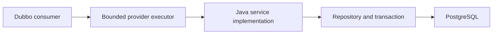

# rest-sample-dubbo-provider

## Version 0.8.1

Published sample 0.8.1 uses REST/platform 4.8.1, Dubbo 0.9.1 and model 0.5.1. It includes
the ARM provenance packaging fix without changing business logic or native ABIs.
Use the aligned 0.8.1 artifacts; earlier 0.8.0 release notes remain historical.
[Patch notes](docs/RELEASE_NOTES_v0.8.1.md).

[English](README.md) | [Türkçe](README.tr.md)

## Compose

**Unpublished source workflow.** This topology and the new helper-based examples
below require coordinated checkout changes, not the published sample `0.8.1` alone.
Matching REST/platform, cache and Dubbo source dependencies must already be installed
or resolvable. `--prepare` / `-Prepare` packages the samples; it does not build those
framework dependencies. New JNI exports also need matching REST native resources;
existing ABI numbers are unchanged. Kubernetes validation is not Compose-engine
execution proof, and this recipe does not establish ARM hardware qualification.

The shared topology is in sibling `rest-sample-cache-reader/docker/compose/`;
see the [complete guide](https://github.com/esasmer-dou/rest-sample-cache-reader/blob/master/README.md#compose).
Clone all four samples under one parent with their repository names. Prerequisites:
Linux/amd64 Docker Engine, Compose v2 with `--wait`, JDK 21/Maven and resolvable
aligned dependencies; Bash needs `curl`, `jq`, `timeout`, or use PowerShell 7.
Run from this repository's root:

```bash
bash ../rest-sample-cache-reader/scripts/verify-compose-topology.sh --prepare
# Alternative: native-provider + matching native-static-consumer
bash ../rest-sample-cache-reader/scripts/verify-compose-topology.sh --prepare --native-provider
```

PowerShell: `pwsh -File ../rest-sample-cache-reader/scripts/verify-compose-topology.ps1 -Prepare`
(add `-NativeProvider` for the alternative). Preparation builds all four samples
with tests skipped and copies runtime dependencies. Default `full-provider` serves
customer query/command RPCs against seeded PostgreSQL; `full-dubbo-consumer` exposes
HTTP at `127.0.0.1:18082`, reader at `127.0.0.1:18081`. Redis 7 and writer complete
the projection pipeline. All six containers have 1 CPU / 128 MiB limits; apps use
OpenJ9 Java 21/JNI. Provider has no HTTP health API: TCP readiness is strengthened
by consumer RPC readiness at `/app/ready`.

**Native mode is catalog-only**, using `CatalogJsonService` version `0.0.0`, not
the full consumer's `NestedCatalogService`. It needs `native-static-consumer` plus
the unchanged sibling ABI-3 library/resources documented in the guide. It does not
replace customer query/command RPCs. Full smoke covers POST/PATCH-to-provider-to-DB
and DB-to-writer-to-fenced-Redis-to-reader. Native smoke covers catalog RPC and that
changing cache pipeline using direct SQL, explicitly bypassing the provider; no
customer RPC or streaming proof is claimed.

Evidence, including five bounded RSS samples, is in the shared parent's `.tmp/wp3-*`.
Default cleanup removes only the unique smoke stack/volume; `--keep` / `-Keep`
retains it. Failures return nonzero; inspect `containers.log` and `result.properties`.
The idiomatic full provider keeps SQL/business contracts explicit; the narrower
native profile is not an equivalent benchmark workload. This single-DB/Redis demo
is not HA. Neither limits nor this recipe prove runtime RSS, throughput or p99.

## Start With 0.8.1

Separate native-provider and native DB-query profiles show bounded query/streaming paths. The normal provider profile remains available. Choose one build profile and keep consumer/model/interface versions aligned.

[Usage guide](docs/functional-operations.md) · [Release notes](docs/RELEASE_NOTES_v0.8.1.md)


New usage guide: [New usage examples](docs/functional-operations.md).

Optional source profile: [Native provider without Netty or HessianLite](docs/NATIVE_PROVIDER.md).

A plain Java Dubbo provider used by the Rust-Java REST consumer sample.

- It does not use Spring Boot.
- It can run without ZooKeeper.
- It can register itself in ZooKeeper.
- It can serve ready JSON or typed records.
- The full profile uses PostgreSQL and HikariCP.

Current versions: `rust-java-platform-parent:4.8.1`, `java-rust-dubbo:0.9.1`, `rest-sample-utility:0.5.1`, `rust-sample-model:0.5.1`.

### Compact Segment Query

`CustomerQueryService.findCustomersBySegmentUtf8(long limit, byte[] segmentUtf8)`
accepts a UTF-8 segment and returns the same customer JSON as the JSON-command
method. The provider rejects malformed UTF-8, inputs over 4096 bytes and limits
outside the Java `int` range. Java still validates the request and runs the same
database query; results are not cached. The earlier JSON-command method remains.
The contract is included in published `rest-sample-utility:0.5.0`, and the matching
provider and consumer `0.8.0` JARs include the implementation. Use those matching
artifacts before enabling `sample.consumer.segment-native-json=true` in the
consumer. It is off by default. Availability is not a performance guarantee.

## Read This First

### Optional segment JSON contract in the current source

`CustomerQueryService.findCustomersBySegmentJson(byte[])` accepts a small JSON
request such as `{"segment":"standard","limit":5}`. It runs the same bounded
SQL as the typed query and returns `{"customers":[...]}` with the same seven
customer fields. Validation and data access remain Java business code. The
consumer can forward the result through Rust without decoding a customer DTO list.
The input limit is 4096 bytes. The existing typed method is not removed. Update
the shared contract and both applications before enabling the consumer option
`sample.consumer.segment-native-json=true`.


Package only the service surface this provider exports. A runtime property can disable behavior,
but it cannot remove already packaged Dubbo, database, model, or service classes.

| Copy | Replace in your provider |
| --- | --- |
| Maven profile split | Your catalog/query/command service groups |
| Shared interfaces and records | Your versioned wire contracts |
| Bounded interface/method executor settings | Limits measured against your DB and CPU capacity |
| Hikari and transaction boundaries | Your datasource, SQL, indexes, and idempotency rules |
| Optional ZooKeeper registration | Your deployment discovery model |

The POM inherits `rust-java-platform-parent` for aligned Java, library, processor, and build-gate
versions. The provider deliberately does not use a REST starter. Maven profiles physically select
the provider surface before packaging, and the shaded JAR excludes build-only processor metadata.

Read the plain-Java boundary in [Glowroot Agent Use](#glowroot-agent-use) before adding telemetry.

## Current Checkout

This update aligns the platform with REST `4.8.1` and optional agent `0.7.1`.
Use the native file packaged with the dependency you selected. Do not mix older SO/DLL files.
Business code, URLs and configuration keys stay the same. Telemetry remains disabled by default.
The HTTP micro memory gate does not guarantee the same overhead for a database job or a richer profile.

Version `0.8.1` uses platform parent `4.8.1`. Rebuild the application with the aligned
dependencies. See [release notes](docs/RELEASE_NOTES_v0.8.1.md). Runtime settings and URLs are unchanged.

- Full, catalog-only, and DB-query-only artifacts stay isolated Maven profiles.
- Workspace Docker builds install the exact aligned REST and Dubbo artifacts before packaging.
- The provider remains plain Java and keeps explicit service registration.
- Provider interfaces, SQL behavior, HikariCP settings, and optional ZooKeeper registration are
  unchanged.
- Build-time platform and ABI checks are aligned with REST `4.8.1`.

## Explicit Provider Flow

| You own | Shared library owns | Runtime rule |
| --- | --- | --- |
| Service implementation and business rules | Interface and record contracts | Consumer and provider use the same contract version |
| Repository SQL and transaction boundary | Generated JDBC record mapper where selected | No reflective row mapping |
| HikariCP limits | Provider bootstrap helpers | DB capacity remains explicit |
| Per-interface and per-method concurrency | Bounded service executor | One slow method cannot consume unbounded threads |
| Static or ZooKeeper registration choice | Registry adapter | ZooKeeper is not required for static Service DNS consumers |



The provider stays plain Java. It does not move business logic into Rust. Select a smaller Maven
profile when the process does not need customer commands or database access; runtime properties
cannot remove classes already packaged in a full artifact.

## Start Here

Choose one provider shape.

| Need | Maven profile | Includes |
|---|---|---|
| Small ready-JSON catalog provider | `catalog-static-provider` | One catalog interface; no DB and no ZooKeeper |
| Read-only PostgreSQL provider | `db-query-provider` | Customer queries and HikariCP; no commands |
| Catalog, queries, and commands | `full-provider` | Full sample; active by default |

Do not package the full provider when the service only needs one catalog method. The smaller profile loads fewer classes and uses less memory.

## Quick Start

### Option A: Small catalog provider

Run from this repository:

```powershell
$env:GITHUB_PACKAGES_TOKEN="YOUR_TOKEN_WITH_READ_PACKAGES"

mvn -q -Pcatalog-static-provider clean package

java `
  "-Ddubbo.provider.host=127.0.0.1" `
  "-Ddubbo.provider.bind-host=127.0.0.1" `
  "-Ddubbo.provider.port=20880" `
  "-Dreactor.dubbo.registry-enabled=false" `
  -jar target/rest-sample-dubbo-provider-0.8.1.jar
```

Use it with the consumer's `native-static-consumer` profile.

### Option B: Full provider with PostgreSQL

Start PostgreSQL:

```powershell
docker rm -f rs-provider-postgres-test 2>$null

docker run -d --name rs-provider-postgres-test `
  -e POSTGRES_DB=reactor_sample `
  -e POSTGRES_USER=reactor `
  -e POSTGRES_PASSWORD=reactor `
  -p 15432:5432 postgres:16-alpine
```

Build and start the provider:

```powershell
$env:GITHUB_PACKAGES_TOKEN="YOUR_TOKEN_WITH_READ_PACKAGES"

mvn -q clean package

java `
  "-Dreactor.dubbo.registry-enabled=false" `
  "-Dsample.db.jdbc-url=jdbc:postgresql://127.0.0.1:15432/reactor_sample" `
  "-Dsample.db.username=reactor" `
  "-Dsample.db.password=reactor" `
  "-Dsample.db.schema-init=true" `
  "-Dsample.db.warmup=true" `
  -jar target/rest-sample-dubbo-provider-0.8.1.jar
```

The provider listens on `127.0.0.1:20880`.

Start the consumer with:

```properties
sample.dubbo.discovery=static
reactor.dubbo.providers=127.0.0.1:20880
```

## What the Provider Exposes

### Read-Only Database With Native Transport (Source Checkout)

Use the new `native-db-query-provider` profile when this process only serves
`CustomerQueryService`. It keeps PostgreSQL, Hikari and the Java business service.
Generated codecs and Rust replace the official Dubbo/Netty transport. It does not
export commands, catalog services or a ZooKeeper registration. The normal full
provider remains unchanged. The profile is present in this `0.8.1` source checkout.
Build the matching checkout and native library; this guide does not establish
published package availability.

```powershell
mvn -B -ntp clean package -Pnative-db-query-provider
java `
  "-Dreactor.dubbo.native.path=C:/app/native/rust_dubbo-windows-x64.dll" `
  "-Dsample.db.jdbc-url=jdbc:postgresql://127.0.0.1:15432/reactor_sample" `
  "-Dsample.db.username=reactor" "-Dsample.db.password=reactor" `
  -jar target/native-db-query-provider/rest-sample-dubbo-provider-0.8.1.jar
```

The database schema must exist. For Linux, use the matching ABI-3 `librust_dubbo.so`
path instead of the Windows DLL. Configure the consumer with the same static address
as the normal provider. The six query methods, interface name, records, lists and
HTTP response shapes stay the same. Only call query routes with this profile.

**Consumer 0.8.1:** the readiness selection and catalog gate
below were added after published `0.8.0`. Rebuild the consumer checkout; an existing
downloaded `0.8.0` consumer jar does not support these settings or the query-only overlay.

Use the normal `full-dubbo-consumer` build with its standalone
`config/query-only.properties` overlay, not the default full readiness contract:

```properties
sample.consumer.surface=full
sample.consumer.readiness.contracts=query-only
sample.consumer.catalog.enabled=false
sample.dubbo.discovery=static
reactor.dubbo.providers=rest-sample-dubbo-provider:20880
```

The [consumer run recipe](https://github.com/esasmer-dou/rest-sample-dubbo-consumer#readiness-contract-selection)
shows how to load this file at startup and override the address. Catalog clients
and routes are omitted; readiness requires the customer query RPC and reports
catalog as `SKIPPED`. Missing/failed required queries return `503`. Command routes
remain in that consumer build for compatibility but are unsupported by this provider;
readiness selection is not a read-only access-control policy.

| Setting | Default | Purpose |
| --- | --- | --- |
| `sample.native-provider.business-workers` | `2` | Bounds Java query execution threads. |
| `sample.native-provider.service-max-concurrent` | `2` | Bounds concurrent query work. |
| `sample.db.maximum-pool-size` | `2` | Bounds PostgreSQL connections. |
| `sample.db.read-only` | `true` | Makes pooled DB sessions read-only. |
| `sample.db.schema-init` | `false` | Leaves schema migration outside this process. |

Keep the worker, service concurrency and DB pool limits aligned. Increasing an HTTP
queue timeout does not make a saturated provider faster. Validate startup bursts,
steady traffic and consumer peak RSS separately before selecting this profile.

This is an opt-in source profile, not the default production recipe. Previously
recorded six-query checks do not establish acceptance of the current deployment.
Validate combined cold-load and consumer-memory behavior in the target environment.
Do not treat lower provider RSS as a guarantee for the full stack.

The provider does not expose HTTP endpoints. It exports Dubbo interfaces.

| Interface | Example methods | Data shape |
|---|---|---|
| `CatalogJsonService` | `getNestedCatalogJson()` | Ready JSON `byte[]` |
| `NestedCatalogService` | title, count, info, item list, attributes | String, primitive, record, list, map |
| `CustomerQueryService` | customer, segment list, stats, exists | Ready JSON and typed results |
| `CustomerCommandService` | create, patch, delete | JSON bytes and typed command records |

The shared interface package must stay `com.reactor.rust.dubbo.sample`. Dubbo uses the full interface name as the service identity.

## Static Address or ZooKeeper?

### Without ZooKeeper

Use this when the consumer reaches the provider through a known address or Kubernetes Service DNS.

```properties
reactor.dubbo.registry-enabled=false
dubbo.provider.bind-host=0.0.0.0
dubbo.provider.port=20880
```

Kubernetes example:

```text
rest-sample-dubbo-provider:20880
```

The Service can point to one or many provider pods.

### With ZooKeeper

Use this when the provider must register itself in a Dubbo registry.

```properties
reactor.dubbo.registry-enabled=true
reactor.dubbo.registry-address=zookeeper://zookeeper-client.platform.svc.cluster.local:2181
reactor.dubbo.registry-root=dubbo
```

ZooKeeper is optional. Do not enable it only because the provider uses Dubbo.

## Database and Concurrency Limits

The default production shape is intentionally small:

```properties
sample.db.maximum-pool-size=2
sample.db.minimum-idle=0

dubbo.provider.executor.core-threads=1
dubbo.provider.executor.max-threads=8
dubbo.provider.executor.queue-capacity=16

dubbo.provider.service.CustomerQueryService.max-concurrent=2
dubbo.provider.service.CustomerCommandService.max-concurrent=2
dubbo.provider.service.CustomerCommandService.method.patchCustomerStatus.max-concurrent=1
```

Why:

1. HikariCP has two database connections.
2. Query and command concurrency stays close to real DB capacity.
3. Method caps bound work in one provider process. PostgreSQL row locks still serialize conflicting updates; these caps are not a distributed or cross-method customer lock.
4. A bounded queue prevents unlimited memory growth.

Increase the DB pool and service limits together. First check PostgreSQL CPU, connection count, lock wait, and query latency.

`method.patchCustomerStatus.max-concurrent` and its typed counterpart are concurrency
limits, not per-method timeouts. Consumer RPC timeouts, provider request/drain limits
and DB/SQL waits are independent budgets. A caller timeout does not roll back a
committed write. Optional shared-PostgreSQL idempotency covers the typed status
command only; see the [retry contract](docs/functional-operations.md).

Do not increase only the queue. That delays failures and usually slows the worst requests.

## JSON and DTO Choice

| Need | Provider return type | Result |
|---|---|---|
| Consumer forwards JSON without reading fields | `byte[]` containing UTF-8 JSON | Creates the fewest Java objects |
| Consumer needs one value | Primitive or `String` | Small typed contract |
| Consumer makes business decisions | Small immutable `record` | Clear contract with Hessian decode cost |
| Consumer forwards a large page | Ready JSON `byte[]` | Avoids a large record/list graph |

Typed DTO packages must be present on both sides and allowed by Hessian security:

```text
src/main/resources/security/serialize.allowlist
```

## Configuration

The application reads configuration in this order:

1. `src/main/resources/rest-sample-dubbo-provider.properties`
2. Files passed through `reactor.config.file` or `REACTOR_CONFIG_FILE`
3. JVM `-D...` values and supported environment variables

| File | Purpose |
|---|---|
| `rest-sample-dubbo-provider.properties` | Local provider, registry, service limit, and DB defaults |
| `config/production.properties` | Kubernetes bind address and low-memory HikariCP defaults |
| `config/advanced-tuning.properties` | Per-method limits and Netty/Dubbo memory controls |

Production should run database migrations outside this process:

```properties
sample.db.schema-init=false
```

The sample sets it to `true` only for an easy local start.

## Glowroot Agent Use

The default build adds no agent dependency. Business logic and existing settings stay unchanged.
Choose the optional `glowroot` Maven profile when this process needs telemetry.

```powershell
$env:REACTOR_GLOWROOT_ENABLED="true"
$env:REACTOR_GLOWROOT_PROFILE="micro"
$env:REACTOR_GLOWROOT_COLLECTOR_ADDRESS="http://127.0.0.1:8181"
$env:REACTOR_GLOWROOT_AGENT_ID="dubbo-provider-local"
mvn -Pfull-provider,glowroot clean compile exec:java
```

The profile adds `java-rust-glowroot-spring-runtime:0.7.1` and uses Dubbo library `0.9.1`.
Include `full-provider` explicitly. Selecting another Maven profile can deactivate the default profile. This example is for the full provider; catalog-static and db-query images stay unchanged.

`TelemetryProviderApplication` manages telemetry in the existing provider lifecycle. A startup dispatcher decorator reports methods as transaction type `Dubbo Provider`, name `interface#method`.
This low-level provider deliberately bypasses Dubbo SPI filters. It does not restore the full filter chain or add reflection/proxies to request handling.

No Spring or REST server is added. Enabled telemetry uses the isolated Rust exporter.
No Java executor is created. Payloads, SQL values and customer data are not sent.
Provider observation measures actual business completion, not the consumer's total RPC duration.

Set `REACTOR_GLOWROOT_ENABLED=false` to turn telemetry off.
Build without the `glowroot` profile to remove its dependencies as well.
Adding the bootstrap JAR alone does not start this lifecycle.

Add a server with id `github-glowroot` to Maven `settings.xml`.
Use a valid `read:packages` token. SSH does not download Maven packages.
Start with `micro`. The HTTP gate's 3 MiB steady paired-median bound is not
a per-load memory guarantee for this application.

[Setup and profile details](https://github.com/esasmer-dou/java-rust-glowroot-agent/blob/v0.7.1/docs/functional-operations.md)

## Container Images

| Image definition | Use |
|---|---|
| `docker/images/Dockerfile.jlink.catalog-static` | Small catalog-only provider |
| `docker/images/Dockerfile.jlink.db-query` | PostgreSQL query-only provider |
| `docker/images/Dockerfile.jlink` | Full provider |
| `docker/images/Dockerfile` | Full Docker Compose provider |

See [`docker/images/README.md`](docker/images/README.md) before building a jlink image. Container builds also need Maven access to the private shared packages.

## Code Map

| File | Why it matters |
|---|---|
| `RestSampleDubboProviderApplication.java` | Starts the full provider |
| `CatalogStaticProviderApplication.java` | Starts the catalog-only provider |
| `DbQueryOnlyProviderApplication.java` | Starts the DB query-only provider |
| `*ProviderModule.java` | Declares exported services |
| `CustomerQueryServiceImpl.java` | DB read examples |
| `CustomerCommandServiceImpl.java` | DB command examples |
| `PostgresCustomerRepository.java` | SQL, transaction, and paging logic |
| `rest-sample-dubbo-provider.properties` | Local settings |

## Maven Package Access

GitHub Packages requires a token with `read:packages`. The token also needs access to the private shared sample repositories.

The server IDs in `~/.m2/settings.xml` must match the POM:

```xml
<servers>
  <server>
    <id>github-java-rust-dubbo</id>
    <username>YOUR_GITHUB_USERNAME</username>
    <password>${env.GITHUB_PACKAGES_TOKEN}</password>
  </server>
  <server>
    <id>github-rest-sample-utility</id>
    <username>YOUR_GITHUB_USERNAME</username>
    <password>${env.GITHUB_PACKAGES_TOKEN}</password>
  </server>
  <server>
    <id>github-rust-sample-model</id>
    <username>YOUR_GITHUB_USERNAME</username>
    <password>${env.GITHUB_PACKAGES_TOKEN}</password>
  </server>
</servers>
```

## Common Problems

| Symptom | Check |
|---|---|
| Maven returns `401` | Token, private repo access, and all server IDs |
| Port `20880` is unavailable | Another provider or container already uses it |
| Consumer cannot connect | Bind host, advertised host, port, Service DNS, and firewall |
| PostgreSQL connection fails | JDBC URL, `15432` port, username, and password |
| Typed DTO is rejected | Shared model version and `serialize.allowlist` |
| Some write requests are much slower | DB lock wait, Hikari pool wait, method limit, and same-row contention |
| `reactor.glowroot.enabled=true` produces no data | The default build has no agent. Build/run `full-provider,glowroot` with `TelemetryProviderApplication`, enable telemetry and check collector settings; a bootstrap JAR or flag alone does not start it |

## Production Checklist

- Package the smallest Maven profile that exports the required interfaces.
- Keep consumer, provider, model, and utility contract versions aligned.
- Set provider advertised host separately from bind host when the platform requires it.
- Bound interface and method concurrency; keep it consistent with Hikari and database capacity.
- Use transactions and idempotency for commands; distinguish same-row contention from normal writes.
- Keep liveness local. Put short provider/database checks in readiness.
- Test consumer/provider startup, provider restart, c16/c64/c256 mixed methods, p99, errors, RSS, and DB pool wait.
- Enable ZooKeeper only when registration/discovery is required by the deployment model.
- Do not add Spring Boot or the REST runtime only for telemetry.

## Glossary

| Term | Meaning |
| --- | --- |
| Provider | Application that implements and exports Dubbo interfaces |
| Bind host | Local interface on which the provider listens |
| Advertised host | Address consumers receive and connect to |
| Interface limit | Shared concurrency boundary for all methods on one service |
| Method override | Smaller or different concurrency limit for one method |
| Pool wait | Time a request waits for a Hikari database connection |
| Bootstrap agent JAR | Small JAR that maps `-javaagent` arguments to properties and contains no runtime |

## More Detail

- [Turkish user guide](docs/USER_GUIDE.tr.md)
- [Turkish PDF guide](docs/rest-sample-dubbo-provider-user-guide.tr.pdf)
- [Docker runbook](docker/README.md)
- [Production settings](src/main/resources/config/production.properties)
- [Advanced tuning](src/main/resources/config/advanced-tuning.properties)
- [v0.8.0 release notes](docs/RELEASE_NOTES_v0.8.0.md)

## Optional Native Provider

The opt-in `native-provider` profile and same-service `stream-catalog-provider`
official baseline are documented in [Native Provider](docs/NATIVE_PROVIDER.md).
The focused warmed-load comparison passed. These modules remain source-only and
do not replace the published default provider; platform distribution is separate.
