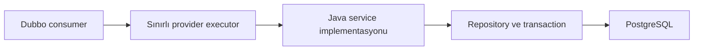

# rest-sample-dubbo-provider

[English](README.md) | [Türkçe](README.tr.md)

## 0.8.0 İle Başlayın

Ayrı native-provider ve native DB-query profilleri, sınırlı sorgu ve streaming yollarını gösterir. Normal provider profili korunur. Tek derleme profili seçin. Consumer, model ve arayüz sürümlerini eşleştirin.

[Kullanım rehberi](docs/functional-operations.md) · [Sürüm notları](docs/RELEASE_NOTES_v0.8.0.md)


İsteğe bağlı kaynak profili: [Netty ve HessianLite gerektirmeyen native provider](docs/NATIVE_PROVIDER.tr.md).

Yeni kullanım rehberi: [Yeni kullanım örnekleri](docs/functional-operations.tr.md).

Rust-Java REST consumer sample'ının kullandığı sade bir Java Dubbo provider uygulamasıdır.

- Spring Boot kullanmaz.
- ZooKeeper olmadan çalışabilir.
- İstenirse ZooKeeper'a kayıt olabilir.
- Hazır JSON veya typed record dönebilir.
- Full profile PostgreSQL ve HikariCP kullanır.

Kullanılan sürümler: `rust-java-platform-parent:4.8.0`, `java-rust-dubbo:0.9.0`, `rest-sample-utility:0.5.0`, `rust-sample-model:0.5.0`.

### Sade Segment Sorgusu (Kaynak Kod)

`CustomerQueryService.findCustomersBySegmentUtf8(long limit, byte[] segmentUtf8)`
metodu segment bilgisini UTF-8 olarak alır. Mevcut JSON komutuyla aynı müşteri
JSON'unu döndürür. Hatalı UTF-8, 4096 byte üzerindeki veri ve Java `int` sınırını
aşan limit reddedilir. Doğrulama ve veritabanı sorgusu Java'da kalır. Sonuç
cache'lenmez. Önceki JSON komutu metodu da kullanılabilir.
Consumer'da `sample.consumer.segment-native-json=true` seçmeden önce utility
sözleşmesini ve provider'ı birlikte güncelleyin. Bu seçenek varsayılan olarak
kapalıdır. Henüz yayımlanmış bir performans garantisi değildir.

## Önce Bu Bölümü Okuyun

### Güncel kaynakta isteğe bağlı segment JSON kontratı

`CustomerQueryService.findCustomersBySegmentJson(byte[])`,
`{"segment":"standard","limit":5}` gibi küçük bir JSON istek alır.
Typed sorguyla aynı sınırlı SQL'i çalıştırır. Cevap yine yedi müşteri alanını
içeren `{"customers":[...]}` biçimindedir. Doğrulama ve veritabanı işlemi
Java kodunda kalır. Consumer listeyi DTO'lara açmadan Rust üzerinden iletebilir.
İstek sınırı 4096 byte olur. Eski typed metot kaldırılmaz. Önce ortak kontratı
ve iki uygulamayı güncelleyin. Sonra consumer'da
`sample.consumer.segment-native-json=true` seçeneğini açın.


Yalnız provider'ın sunduğu service yüzeyini paketleyin. Runtime property davranışı kapatabilir;
ancak pakete girmiş Dubbo, database, model veya service sınıflarını çıkaramaz.

| Kopyalayın | Kendi provider'ınızda değiştirin |
| --- | --- |
| Maven profile ayrımı | Katalog, sorgu ve command service gruplarınız |
| Ortak interface ve record'lar | Sürümlü wire kontratlarınız |
| Sınırlı interface/metot executor ayarları | DB ve CPU kapasitenizle ölçülen limitler |
| Hikari ve transaction sınırları | Datasource, SQL, index ve idempotency kurallarınız |
| Opsiyonel ZooKeeper kaydı | Deployment discovery modeliniz |

POM, Java, library, processor ve build gate sürümlerini hizalamak için `rust-java-platform-parent`
kullanır. Provider bilinçli olarak REST starter kullanmaz. Maven profile'ları paketleme öncesinde
provider yüzeyini fiziksel olarak seçer. Shaded JAR build-only processor metadata'sını içermez.

Telemetri eklemeden önce [Glowroot Agent Kullanımı](#glowroot-agent-kullanımı) bölümündeki plain-Java
sınırını okuyun.

## Güncel Kaynak Ayarları

Bu güncelleme, platformu REST `4.8.0` ve isteğe bağlı agent `0.7.1` ile eşler.
Seçtiğiniz bağımlılığın native dosyasını kullanın. Eski SO/DLL dosyalarını karıştırmayın.
İş kodu, URL'ler ve ayar anahtarları değişmez. Telemetri varsayılan olarak kapalıdır.
HTTP micro bellek testi, veritabanı işinde veya daha ayrıntılı profilde aynı maliyeti garanti etmez.

`0.8.0` sürümü platform parent `4.8.0` kullanır. Uygulamayı hizalanmış bağımlılıklarla
yeniden derleyin. [Sürüm notlarını](docs/RELEASE_NOTES_v0.8.0.tr.md) okuyun. Runtime ayarları ve adresler değişmez.

- Full, yalnız katalog ve yalnız DB sorgu artifact'leri ayrı Maven profile olarak kalır.
- Workspace Docker build, paketlemeden önce uyumlu REST ve Dubbo artifact'lerini kurar.
- Provider sade Java kullanmaya ve service'leri açıkça kaydetmeye devam eder.
- Provider interface'leri, SQL davranışı, HikariCP ayarları ve opsiyonel ZooKeeper kaydı değişmedi.
- Build sırasındaki platform ve ABI kontrolleri REST `4.8.0` ile hizalandı.

## Açık Provider Akışı

| Sizin yönettiğiniz alan | Ortak library'nin yönettiği alan | Runtime kuralı |
| --- | --- | --- |
| Service implementasyonu ve business rule | Interface ve record kontratları | Consumer ve provider aynı kontrat sürümünü kullanır |
| Repository SQL ve transaction sınırı | Seçildiğinde generated JDBC record mapper | Reflective row mapping yok |
| HikariCP limitleri | Provider başlangıç yardımcıları | DB kapasitesi açık biçimde yönetilir |
| Interface ve metot bazlı concurrency | Bounded service executor | Yavaş bir metot sınırsız thread tüketmez |
| Static veya ZooKeeper kayıt seçimi | Registry adapter | Static Service DNS consumer için ZooKeeper zorunlu değildir |



Provider sade Java olarak kalır. Business logic Rust'a taşınmaz. Process müşteri command veya DB
erişimi kullanmıyorsa daha küçük Maven profile seçin. Runtime property, full artifact içine zaten
paketlenmiş sınıfları çıkaramaz.

## Buradan Başlayın

Önce provider tipini seçin.

| İhtiyaç | Maven profile | İçerik |
|---|---|---|
| Küçük, hazır JSON katalog provider | `catalog-static-provider` | Tek katalog interface'i; DB ve ZooKeeper yok |
| Yalnızca PostgreSQL okuyan provider | `db-query-provider` | Müşteri sorguları ve HikariCP; komut yok |
| Katalog, sorgu ve komut | `full-provider` | Tam sample; varsayılan profil |

Servis yalnızca tek catalog metoduna ihtiyaç duyuyorsa full provider paketlemeyin. Küçük profile daha az sınıf yükler ve daha az memory kullanır.

## Hızlı Başlangıç

### Seçenek A: Küçük katalog provider

Bu repo dizininde çalıştırın:

```powershell
$env:GITHUB_PACKAGES_TOKEN="READ_PACKAGES_YETKILI_TOKEN"

mvn -q -Pcatalog-static-provider clean package

java `
  "-Ddubbo.provider.host=127.0.0.1" `
  "-Ddubbo.provider.bind-host=127.0.0.1" `
  "-Ddubbo.provider.port=20880" `
  "-Dreactor.dubbo.registry-enabled=false" `
  -jar target/rest-sample-dubbo-provider-0.8.0.jar
```

Bu provider'ı consumer'ın `native-static-consumer` profile'ı ile kullanın.

### Seçenek B: PostgreSQL kullanan tam provider

PostgreSQL'i başlatın:

```powershell
docker rm -f rs-provider-postgres-test 2>$null

docker run -d --name rs-provider-postgres-test `
  -e POSTGRES_DB=reactor_sample `
  -e POSTGRES_USER=reactor `
  -e POSTGRES_PASSWORD=reactor `
  -p 15432:5432 postgres:16-alpine
```

Provider'ı build edip başlatın:

```powershell
$env:GITHUB_PACKAGES_TOKEN="READ_PACKAGES_YETKILI_TOKEN"

mvn -q clean package

java `
  "-Dreactor.dubbo.registry-enabled=false" `
  "-Dsample.db.jdbc-url=jdbc:postgresql://127.0.0.1:15432/reactor_sample" `
  "-Dsample.db.username=reactor" `
  "-Dsample.db.password=reactor" `
  "-Dsample.db.schema-init=true" `
  "-Dsample.db.warmup=true" `
  -jar target/rest-sample-dubbo-provider-0.8.0.jar
```

Provider `127.0.0.1:20880` adresinde çalışır.

Consumer'ı şu ayarlarla başlatın:

```properties
sample.dubbo.discovery=static
reactor.dubbo.providers=127.0.0.1:20880
```

## Provider Neler Sunar?

### Yalnız DB Sorguları İçin Native Taşıma (Kaynak Kod)

Bu süreç yalnız `CustomerQueryService` sunacaksa yeni `native-db-query-provider`
profilini seçebilirsiniz. PostgreSQL, Hikari ve Java iş servisi korunur. Resmi
Dubbo/Netty taşıması yerine üretilmiş codec'ler ve Rust kullanılır. Command ve
katalog servisleri yayınlanmaz. ZooKeeper kaydı yapılmaz. Normal tam provider
değişmez. Bu profil, yayımlanmış `0.8.0` paketinde henüz yoktur.

```powershell
mvn -B -ntp clean package -Pnative-db-query-provider
java `
  "-Dreactor.dubbo.native.path=C:/app/native/rust_dubbo-windows-x64.dll" `
  "-Dsample.db.jdbc-url=jdbc:postgresql://127.0.0.1:15432/reactor_sample" `
  "-Dsample.db.username=reactor" "-Dsample.db.password=reactor" `
  -jar target/native-db-query-provider/rest-sample-dubbo-provider-0.8.0.jar
```

Veritabanı şeması önceden hazırlanmış olmalıdır. Linux'ta Windows DLL yerine aynı
ABI-3 sürümüne ait `librust_dubbo.so` yolunu verin. Consumer'ın static adres ayarı
değişmez. Altı sorgu metodu, interface adı, record ve list dönüşleri, HTTP yanıt
biçimleri korunur. Bu profille yalnız sorgu rotalarını çağırın.

| Ayar | Varsayılan | Ne işe yarar? |
| --- | --- | --- |
| `sample.native-provider.business-workers` | `2` | Java sorgu thread sayısını sınırlar. |
| `sample.native-provider.service-max-concurrent` | `2` | Aynı anda çalışan sorguları sınırlar. |
| `sample.db.maximum-pool-size` | `2` | PostgreSQL bağlantı sayısını sınırlar. |
| `sample.db.read-only` | `true` | Havuzdaki DB oturumlarını salt okunur yapar. |
| `sample.db.schema-init` | `false` | Şema hazırlığını bu sürecin dışında bırakır. |

Worker, servis eşzamanlılığı ve DB havuzu sınırlarını birlikte değerlendirin.
HTTP kuyruk süresini uzatmak, dolu provider'ı hızlandırmaz. Bu profili seçmeden önce
başlangıç yükünü, kararlı trafiği ve consumer tepe RSS'ini ayrı ayrı ölçün.

Bu profil, kaynak koddan seçilen bir önizlemedir. Varsayılan production reçetesi değildir.
Altı sorgu metodunun canlı kontrolleri geçti. Başlangıç yükü ve consumer belleği için
birleşik kabul hâlâ açıktır. Provider RSS'inin düşmesi, tüm sistemin kabulü anlamına gelmez.

Provider HTTP endpoint açmaz. Dubbo interface'lerini yayınlar.

| Interface | Örnek metotlar | Veri tipi |
|---|---|---|
| `CatalogJsonService` | `getNestedCatalogJson()` | Hazır JSON `byte[]` |
| `NestedCatalogService` | başlık, adet, bilgi, ürün listesi, özellikler | String, primitive, record, list, map |
| `CustomerQueryService` | müşteri, segment listesi, istatistik, varlık kontrolü | Hazır JSON ve typed sonuçlar |
| `CustomerCommandService` | create, patch, delete | JSON byte'ları ve typed command record'ları |

Ortak interface package adı `com.reactor.rust.dubbo.sample` olarak kalmalıdır. Dubbo, tam interface adını service kimliği olarak kullanır.

## Static Adres mi, ZooKeeper mı?

### ZooKeeper olmadan

Consumer provider'a bilinen bir adres veya Kubernetes Service DNS üzerinden ulaşıyorsa bunu kullanın.

```properties
reactor.dubbo.registry-enabled=false
dubbo.provider.bind-host=0.0.0.0
dubbo.provider.port=20880
```

Kubernetes örneği:

```text
rest-sample-dubbo-provider:20880
```

Service bir veya birden fazla provider pod'una yönlenebilir.

### ZooKeeper ile

Provider bir Dubbo registry'ye kayıt olacaksa ZooKeeper kullanın.

```properties
reactor.dubbo.registry-enabled=true
reactor.dubbo.registry-address=zookeeper://zookeeper-client.platform.svc.cluster.local:2181
reactor.dubbo.registry-root=dubbo
```

Dubbo kullanmak ZooKeeper'ı zorunlu yapmaz. Gerçek bir registry ihtiyacı yoksa ZooKeeper'ı açmayın.

## Veritabanı ve Eşzamanlı İstek Limitleri

Varsayılan production yapısı bilinçli olarak küçüktür:

```properties
sample.db.maximum-pool-size=2
sample.db.minimum-idle=0

dubbo.provider.executor.core-threads=1
dubbo.provider.executor.max-threads=8
dubbo.provider.executor.queue-capacity=16

dubbo.provider.service.CustomerQueryService.max-concurrent=2
dubbo.provider.service.CustomerCommandService.max-concurrent=2
dubbo.provider.service.CustomerCommandService.method.patchCustomerStatus.max-concurrent=1
```

Bu değerlerin nedeni:

1. HikariCP iki database bağlantısı kullanır.
2. Query ve command concurrency gerçek DB kapasitesine yakın kalır.
3. Aynı satırı değiştiren işlemler tek tek çalışır.
4. Sınırlı queue, memory'nin kontrolsüz büyümesini engeller.

Veritabanı bağlantı havuzu ile servis limitlerini birlikte artırın. Önce PostgreSQL CPU, bağlantı sayısı, kilit bekleme ve sorgu gecikmesi değerlerine bakın.

Yalnızca queue değerini artırmayın. Bu yaklaşım hatayı geciktirir ve en yavaş istekleri daha da yavaşlatır.

## JSON ve DTO Seçimi

| İhtiyaç | Provider dönüş tipi | Sonuç |
|---|---|---|
| Consumer JSON'u alanlarını okumadan iletecek | UTF-8 JSON içeren `byte[]` | En az Java nesnesini oluşturur |
| Consumer tek bir değer kullanacak | Primitive veya `String` | Küçük typed sözleşme |
| Consumer iş kararı verecek | Küçük immutable `record` | Açık sözleşme ve Hessian decode maliyeti |
| Consumer büyük bir sayfayı doğrudan iletecek | Hazır JSON `byte[]` | Büyük record/list grafiği oluşmaz |

Typed DTO package'ları iki tarafta da bulunmalı ve Hessian güvenlik listesine eklenmelidir:

```text
src/main/resources/security/serialize.allowlist
```

## Konfigürasyon

Uygulama ayarları şu sırayla okur:

1. `src/main/resources/rest-sample-dubbo-provider.properties`
2. `reactor.config.file` veya `REACTOR_CONFIG_FILE` ile verilen dosyalar
3. JVM `-D...` değerleri ve desteklenen environment variable'lar

| Dosya | Amacı |
|---|---|
| `rest-sample-dubbo-provider.properties` | Lokal provider, registry, service limiti ve DB ayarları |
| `config/production.properties` | Kubernetes bind adresi ve düşük memory HikariCP ayarları |
| `config/advanced-tuning.properties` | Metot bazlı limitler ve Netty/Dubbo memory ayarları |

Production ortamında database migration işlemini bu process dışında çalıştırın:

```properties
sample.db.schema-init=false
```

Sample bu değeri yalnızca kolay lokal başlangıç için `true` yapar.

## Glowroot Agent Kullanımı

Varsayılan derleme agent bağımlılığı eklemez. İş mantığı ve mevcut ayarlar değişmez.
Telemetri gerekiyorsa `glowroot` Maven profilini seçin.

```powershell
$env:REACTOR_GLOWROOT_ENABLED="true"
$env:REACTOR_GLOWROOT_PROFILE="micro"
$env:REACTOR_GLOWROOT_COLLECTOR_ADDRESS="http://127.0.0.1:8181"
$env:REACTOR_GLOWROOT_AGENT_ID="dubbo-provider-local"
mvn -Pfull-provider,glowroot clean compile exec:java
```

Profil, `java-rust-glowroot-spring-runtime:0.7.1` paketini ekler. Dubbo kütüphanesi `0.9.0` kullanılır.
`full-provider` profilini komuta mutlaka ekleyin. Açık profil seçimi varsayılan profili kapatabilir. Bu örnek tam provider içindir; catalog-static ve db-query image'ları değişmez.

`TelemetryProviderApplication` agent'ı mevcut provider yaşam döngüsüne bağlar. Başlangıçta bağlanan dispatcher gözlemi, servisleri Collector UI'da `Dubbo Provider` türünde `interface#method` adıyla gösterir.
Bu düşük-overhead provider, Dubbo SPI filtrelerini bilinçli olarak atlar. Tüm filtre zinciri geri açılmaz. İstek işlenirken reflection veya proxy eklenmez.

Spring veya REST sunucusu eklenmez. Agent açıksa izole Rust exporter çalışır.
Yeni Java executor oluşturulmaz. Payload, SQL değeri veya müşteri bilgisi gönderilmez.
Provider ölçümü işin gerçek tamamlanma süresidir. Consumer'ın gördüğü toplam RPC süresiyle aynı değildir.

`REACTOR_GLOWROOT_ENABLED=false` ile agent'ı kapatın.
Bağımlılığı da çıkarmak için `glowroot` profilini seçmeden derleyin.
Bootstrap JAR'ını tek başına eklemek bu yaşam döngüsünü başlatmaz.

Maven `settings.xml` dosyasına `github-glowroot` kimlikli server ekleyin.
Geçerli `read:packages` token'ı kullanın. SSH Maven paketlerini indirmez.
`micro` ile başlayın. HTTP testindeki 3 MiB boşta medyan sınırı, bu uygulamanın
her iş yükünde aynı maliyetle çalışacağının garantisi değildir.

[Kurulum ve profil ayrıntıları](https://github.com/esasmer-dou/java-rust-glowroot-agent/blob/v0.7.1/docs/functional-operations.tr.md)

## Container Image'ları

| Image tanımı | Kullanım |
|---|---|
| `docker/images/Dockerfile.jlink.catalog-static` | Küçük catalog-only provider |
| `docker/images/Dockerfile.jlink.db-query` | PostgreSQL query-only provider |
| `docker/images/Dockerfile.jlink` | Full provider |
| `docker/images/Dockerfile` | Docker Compose içinde çalışan full provider |

Jlink image oluşturmadan önce [`docker/images/README.md`](docker/images/README.md) dosyasını okuyun. Container build işlemi private ortak package'lara Maven erişimi de ister.

## Kod Haritası

| Dosya | Görevi |
|---|---|
| `RestSampleDubboProviderApplication.java` | Full provider'ı başlatır |
| `CatalogStaticProviderApplication.java` | Catalog-only provider'ı başlatır |
| `DbQueryOnlyProviderApplication.java` | DB query-only provider'ı başlatır |
| `*ProviderModule.java` | Yayınlanan servisleri tanımlar |
| `CustomerQueryServiceImpl.java` | DB okuma örneklerini içerir |
| `CustomerCommandServiceImpl.java` | DB command örneklerini içerir |
| `PostgresCustomerRepository.java` | SQL, transaction ve paging işlemlerini yönetir |
| `rest-sample-dubbo-provider.properties` | Lokal ayarları taşır |

## Maven Package Erişimi

GitHub Packages için `read:packages` yetkili token gerekir. Token'ın private ortak sample repolarına da erişimi olmalıdır.

`~/.m2/settings.xml` içindeki server kimlikleri POM ile aynı olmalıdır:

```xml
<servers>
  <server>
    <id>github-java-rust-dubbo</id>
    <username>GITHUB_KULLANICI_ADI</username>
    <password>${env.GITHUB_PACKAGES_TOKEN}</password>
  </server>
  <server>
    <id>github-rest-sample-utility</id>
    <username>GITHUB_KULLANICI_ADI</username>
    <password>${env.GITHUB_PACKAGES_TOKEN}</password>
  </server>
  <server>
    <id>github-rust-sample-model</id>
    <username>GITHUB_KULLANICI_ADI</username>
    <password>${env.GITHUB_PACKAGES_TOKEN}</password>
  </server>
</servers>
```

## Sık Karşılaşılan Sorunlar

| Belirti | Kontrol edin |
|---|---|
| Maven `401` dönüyor | Token, private repo erişimi ve bütün server kimlikleri |
| `20880` portu kullanılamıyor | Başka bir provider veya container bu portu kullanıyor olabilir |
| Consumer bağlanamıyor | Bind host, yayınlanan host, port, Service DNS ve firewall |
| PostgreSQL bağlantısı kurulamıyor | JDBC URL, `15432` portu, kullanıcı adı ve parola |
| Typed DTO reddediliyor | Ortak model sürümü ve `serialize.allowlist` |
| Bazı write istekleri çok yavaş | DB lock bekleme, Hikari pool bekleme, metot limiti ve aynı satır çakışması |
| `reactor.glowroot.enabled=true` yazdım ama veri yok | Bu sade Java provider agent çalışma katmanını başlatmaz; yukarıdaki destek sınırını okuyun |

## Production Kontrol Listesi

- Gerekli interface'leri sunan en küçük Maven profile'ı paketleyin.
- Consumer, provider, model ve utility kontrat sürümlerini hizalı tutun.
- Platform gerektiriyorsa yayınlanan host ile bind host değerini ayrı ayarlayın.
- Interface ve metot concurrency değerlerini sınırlayın; Hikari ve DB kapasitesiyle uyumlu tutun.
- Command işlemlerinde transaction ve idempotency kullanın. Aynı satır çakışmasını normal write yükünden ayırın.
- Liveness kontrolünü lokal tutun. Kısa provider/database kontrollerini readiness'e koyun.
- Consumer/provider başlangıcı, provider restart, c16/c64/c256 karışık metot, p99, hata, RSS ve DB pool wait testi yapın.
- Yalnız deployment modeliniz registration/discovery gerektiriyorsa ZooKeeper açın.
- Yalnız telemetri için Spring Boot veya REST runtime eklemeyin.

## Kısa Sözlük

| Terim | Basit anlamı |
| --- | --- |
| Provider | Dubbo interface'lerini uygulayan ve dışarı açan uygulama |
| Bind host | Provider'ın dinlediği lokal network interface'i |
| Advertised host | Consumer'a bildirilen ve bağlantı kurulan adres |
| Interface limit | Bir service'in bütün metotlarını kapsayan eşzamanlılık sınırı |
| Method override | Tek bir metot için verilen daha küçük veya farklı limit |
| Pool wait | İsteğin Hikari database connection beklediği süre |
| Bootstrap agent JAR | Yalnız `-javaagent` argümanlarını property'lere çeviren, runtime içermeyen küçük JAR |

## Ayrıntılı Bilgi

- [Türkçe kullanıcı rehberi](docs/USER_GUIDE.tr.md)
- [Türkçe PDF rehberi](docs/rest-sample-dubbo-provider-user-guide.tr.pdf)
- [Docker çalışma rehberi](docker/README.tr.md)
- [Production ayarları](src/main/resources/config/production.properties)
- [Advanced tuning ayarları](src/main/resources/config/advanced-tuning.properties)
- [v0.8.0 sürüm notları](docs/RELEASE_NOTES_v0.8.0.tr.md)

## Opsiyonel Native Provider

`native-provider` profili ve aynı Java servisini kullanan resmî motor kontrolü
`stream-catalog-provider`, [Native Provider](docs/NATIVE_PROVIDER.tr.md) belgesindedir.
Odak sıcak yük karşılaştırması geçti. Modüller henüz kaynak düzeyindedir;
yayımlanan varsayılan provider değişmez. Platform dağıtımı ayrı doğrulanacaktır.
